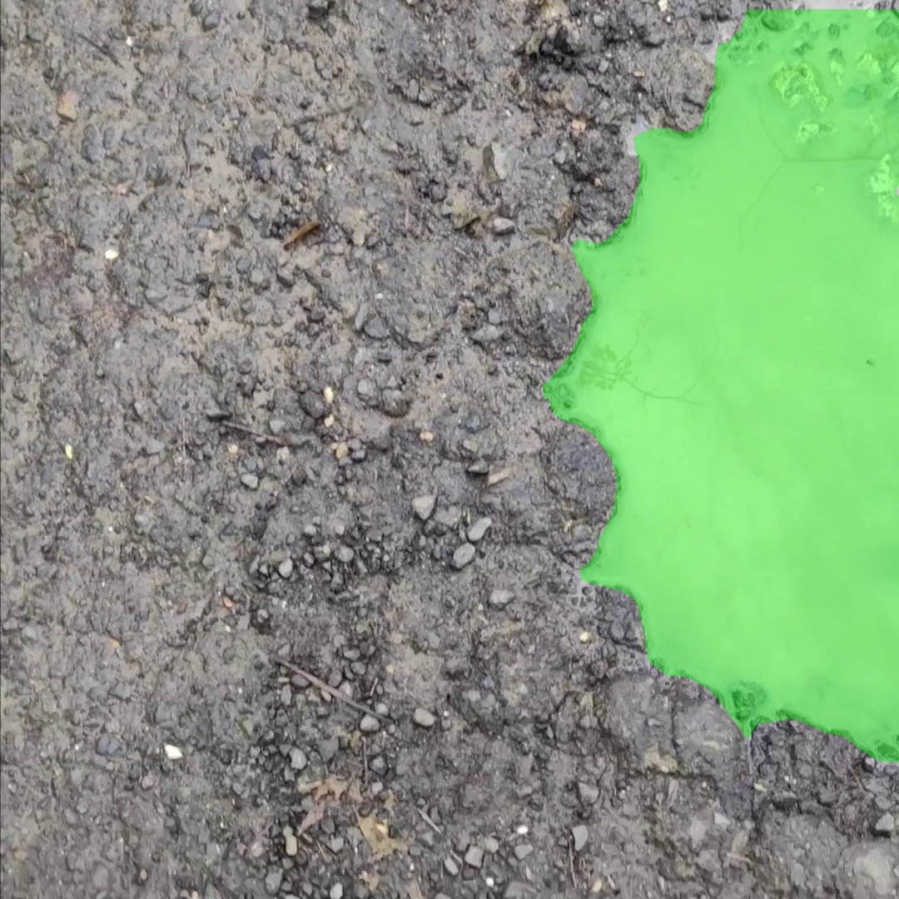
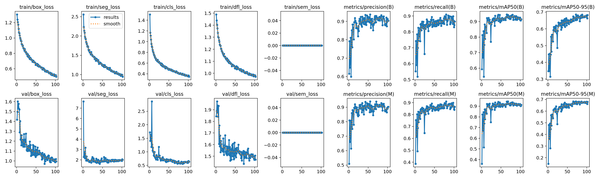
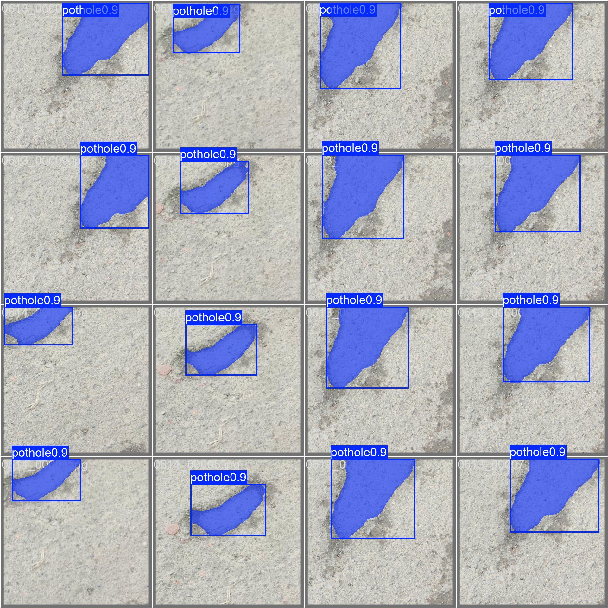

# AI-Powered Pothole Detection and Intelligent Route Planning

This project detects potholes in road videos using instance segmentation (YOLOv8-seg).
It rates each pothole as Mild, Moderate or Severe, places it on a map when a GPS log is
available, and compares candidate routes by how many potholes lie along each one.



## What's in the repo

| Path | What it is |
| --- | --- |
| `config.py` | All paths and hyperparameters in one place |
| `scripts/01–13_*.py` | The pipeline, run in numeric order (see below) |
| `utils/geo.py` | GPS log loading and timestamp → lat/lon interpolation |
| `utils/frames.py` | Video frame extraction and `frames_meta.csv` loading |
| `app.py` + `ui/` | FastAPI backend and web UI: upload a video, see detections on a map, plan routes |
| `android/` | Android app that records road video with a synced GPS log and uploads it to the backend |
| `faster_rcnn/` | Faster R-CNN detection baseline (box-only, for comparison) |
| `runs/pothole_seg/` | Training curves, plots and test metrics of the trained model |
| `tests/` | Unit tests (pytest + Node) |

## Setup

Requires Python 3.10 and, for the UI tests only, Node.js 18+.

```bash
python -m venv venv
venv\Scripts\activate            # Windows  (source venv/bin/activate on Linux/macOS)
pip install -r requirements.txt
```

`requirements.txt` pins `torch==2.12.1`. For GPU training, install the CUDA build of
PyTorch that matches your driver first (see pytorch.org), then install the rest.

### Model weights

Model weights (`*.pt`) are not stored in git because they are too large.

- **Base weights** (`yolov8s-seg.pt` etc.) are downloaded automatically by Ultralytics the
  first time they are used.
- **Trained pothole model**: put the checkpoint at `runs/pothole_seg/weights/best.pt`.
  You can either train it yourself (steps 1–7 below) or download it separately, for
  example from a GitHub Release asset.

### Dataset

The dataset is not included in the repository. The pipeline expects paired road videos
and pothole-mask videos, already split into train, val and test by video:

```
dataset/raw/{train,val,test}/rgb/<id>.mp4    # road footage
dataset/raw/{train,val,test}/mask/<id>.mp4   # matching binary pothole masks
```

## Pipeline

Run the scripts from the repository root, in order. Each script has `--help`.

| Step | Script | Does |
| --- | --- | --- |
| 1 | `01_verify_dataset.py` | Checks every raw video opens and has a mask video with matching fps and size |
| 2 | `02_extract_frames.py` | Keeps every 5th frame of each video pair and writes `frames_meta.csv` |
| 3 | `03_generate_seg_labels.py` | Cleans the masks and converts them to YOLO-seg polygon labels |
| 4 | `04_visualize_seg_labels.py` | Draws the labels on their images for a visual sanity check |
| 5 | `05_dataset_report.py` | Reports corrupt files, split leakage, class imbalance and label anomalies |
| 6 | `06_create_yaml.py` | Writes `data.yaml` (paths relative to the repo, so it works on any machine) |
| 7 | `07_train_seg.py` | Trains YOLOv8s-seg (`--smoke-test` for a quick 3-epoch check) |
| 8 | `08_validate_seg.py` | Box and mask precision, recall, F1 and mAP on a split |
| 9 | `09_infer_seg.py` | Runs inference on a folder of frames (`--track` for video frames) |
| 10 | `10_export_model.py` | Exports to ONNX / TorchScript |
| 11 | `11_classify_severity.py` | Adds a Mild / Moderate / Severe label to each detection |
| 12 | `12_build_detections.py` | Collapses tracks to one record per pothole, adds timestamps and GPS → `results/detections.json` |
| 13 | `13_finetune_local.py` | Fine-tunes on a new local video using pseudo-labels (separate from 1–12) |

Training and validation example:

```bash
python scripts/07_train_seg.py
python scripts/08_validate_seg.py --weights runs/pothole_seg/weights/best.pt --split test
```

Processing a new video by hand (the web UI does the same thing for you):

```bash
python scripts/09_infer_seg.py --weights runs/pothole_seg/weights/best.pt \
    --source path/to/frames --output results/inference \
    --track --frames-meta path/to/frames/frames_meta.csv --geotag path/to/gps.csv
python scripts/11_classify_severity.py
python scripts/12_build_detections.py --frames-meta path/to/frames/frames_meta.csv --geotag path/to/gps.csv
```

### How a video becomes a list of potholes

- **Tracking:** one pothole is visible in many consecutive frames. With `--track`, every
  detection gets a ByteTrack track ID, and step 12 keeps one record per track: the
  highest-confidence frame, plus `frames_seen`. A pothole has to appear in at least two
  sampled frames to be reported, unless it is already visible in the video's first frame.
- **Severity:** based on mask area as a fraction of the frame, plus the shape's
  irregularity and elongation. The thresholds are a heuristic calibrated on a small
  sample (see the docstring of `11_classify_severity.py`), not on human severity grades.
  Area in pixels also depends on how far the pothole is from the camera.
- **GPS:** optional. Supply a CSV with columns `timestamp_sec,lat,lon` (seconds from the
  start of the video). Without it, latitude and longitude are `null`, and detections
  do not appear on the map.

## Web UI

```bash
uvicorn app:app --reload --port 8000
```

Then open http://localhost:8000. Upload a road video, plus a GPS CSV if you have one,
then pick a model and process it. Detections appear on the map and in a sortable,
exportable table. The route planner gets alternative routes from the public OSRM
server and reports how many Severe and Moderate potholes lie within 20 m of each route.

## Android recorder app

`android/` is a small Android app (Java, CameraX) for collecting geotagged road video.
It records video and logs high-accuracy GPS about once a second. Each fix is timed
against the camera's own frame clock, so `timestamp_sec` in the CSV lines up with the
video frames to within a few tens of milliseconds. Recordings can be sent straight to
the web UI's backend over Wi-Fi.

Each recording is saved on the phone as:

| File | Contents |
| --- | --- |
| `road_<date>_<time>.mp4` | Video, no audio |
| `road_<date>_<time>_gps.csv` | `timestamp_sec,lat,lon,accuracy_m,speed_mps,bearing_deg,altitude_m,utc_ms` |
| `road_<date>_<time>.json` | Device, start time (UTC), duration, distance, median GPS accuracy, uploads |

The first three CSV columns are what `utils/geo.py` reads. The CSV also keeps fixes from
up to 5 s before the first frame, with negative timestamps, so the opening frames are
interpolated instead of clamped to one point.

The app needs Android 8.0 or newer with Google Play services (used for location).

### Build the APK

Open `android/` in Android Studio and run it, or build from the command line. Gradle
needs JDK 17 or newer; the JDK bundled with Android Studio works:

```bash
cd android
# Windows (PowerShell):  $env:JAVA_HOME = "C:\Program Files\Android\Android Studio\jbr"
# Windows (Git Bash):    export JAVA_HOME="/c/Program Files/Android/Android Studio/jbr"
./gradlew assembleDebug          # builds app/build/outputs/apk/debug/app-debug.apk
./gradlew testDebugUnitTest      # unit tests for the clock sync and CSV output
```

If Gradle can't find the Android SDK, create `android/local.properties` containing
`sdk.dir=C:/Users/<you>/AppData/Local/Android/Sdk` (forward slashes).

### Install and run the APK

**Over USB (developer machine):**

1. On the phone, turn on Developer options (Settings › About phone › tap *Build number*
   seven times), then turn on **USB debugging**.
2. Connect the phone, accept the "Allow USB debugging" prompt, and check it is listed:
   `adb devices`.
3. Install it: `./gradlew installDebug` from `android/`, or
   `adb install -r app/build/outputs/apk/debug/app-debug.apk`.

**Without a computer:** copy `app-debug.apk` to the phone (USB, Drive, or a chat app),
open it from the Files app, and allow *Install unknown apps* for that app when asked.

Open **Road Recorder** and allow **Camera** and **Location** (choose *Precise* and
*While using the app*). The app opens straight into the camera in landscape.

### Connect it to the detection server

The phone uploads to `app.py` running on a laptop.

- **Over Wi-Fi (normal use):** put the phone and laptop on the same network and start
  the server listening on all interfaces:
  ```bash
  uvicorn app:app --host 0.0.0.0 --port 8000
  ```
  Allow Python through Windows Firewall on **private** networks when prompted. Find the
  laptop's IPv4 address with `ipconfig`, then in the app open **Settings**, enter
  `http://<that address>:8000` and tap **Test connection**. It should report the number
  of models available.
- **Over the USB cable (no Wi-Fi):** run `adb reverse tcp:8000 tcp:8000`, start the
  server with `uvicorn app:app --port 8000`, and set the app's server to
  `http://localhost:8000`. Repeat the `adb reverse` command each time the phone is
  reconnected.

### Capture road video

1. **Mount the phone** on the windscreen or dashboard in **landscape**, rear camera
   facing forward, so the road surface fills the lower half of the frame. A rigid mount
   matters: vibration blurs frames and hurts detection.
2. **Plug in a charger.** Recording with GPS and the screen on drains the battery quickly.
3. **Wait for a GPS lock** before driving off. The dot in the top-left corner shows
   accuracy: green is within 10 m, orange within 30 m, red worse than that. The first fix
   can take up to a minute after the app opens, faster outdoors with a clear sky.
4. **Tap the red button** to start. The chip under the GPS status shows the elapsed time
   and how many GPS fixes have been logged; it should go up about once a second.
5. **Drive normally**, in daylight where possible. Keep the app on screen: switching
   apps or locking the phone stops the recording (the part recorded so far is kept).
   The screen stays on while the app is open.
6. **Tap the button again** to stop. A message confirms the duration, distance and
   number of GPS fixes. If it warns about fewer than 2 GPS fixes, the video is saved but
   its detections can't be placed on the map.

Settings › **Video quality** chooses 720p (default, roughly 0.5 to 1 GB per hour) or 1080p.
Shorter clips of 5 to 15 minutes are easier to upload and process than one long drive.

### Process the recordings

Open **Recordings**. Each recording shows its duration, distance, GPS fix count and
median GPS accuracy.

- **Detect potholes** asks which model to use (the trained model is selected by
  default), uploads the video and GPS log to `/api/process`, and shows upload and
  processing progress. When it finishes, it shows the pothole totals. Tick
  *Add to existing potholes on the map* to keep earlier results in `detections.json`
  instead of replacing them.
- **Open map** opens the web UI on the server, where the detections appear on the map.
- **Share** sends the `.mp4`, `_gps.csv` and `.json` to another app (Drive, Nearby
  Share, email). Upload the `.mp4` and `_gps.csv` together in the web UI to process a
  recording later.
- **Delete** removes a recording from the phone after confirming.

Recordings are stored in the app's folder on the phone. To copy all of them to a
computer over USB:

```bash
adb pull /sdcard/Android/data/com.potholes.roadrecorder/files/sessions
```

(In Git Bash, prefix the command with `MSYS_NO_PATHCONV=1` so the phone path isn't
rewritten.)

## Results

YOLOv8s-seg was trained at 640 px for 102 epochs. Training stopped early (patience 30),
and the best checkpoint is from epoch 72. The data has 3,720 train, 1,240 val and 1,230
test frames from 372, 124 and 123 separate videos. Test-split metrics come from
`08_validate_seg.py` at its default thresholds (conf 0.35, IoU 0.5):

| | Precision | Recall | F1 | mAP@50 | mAP@50-95 |
| --- | --- | --- | --- | --- | --- |
| Mask | 0.959 | 0.907 | 0.932 | 0.905 | 0.681 |
| Box | 0.936 | 0.896 | 0.916 | 0.879 | 0.678 |





## Tests

```bash
python -m pytest tests
node --test tests/route_scoring.test.js
```

`tests/test_infer_seg.py` runs the real model end to end. It is skipped when
`runs/pothole_seg/weights/best.pt` is not present.
